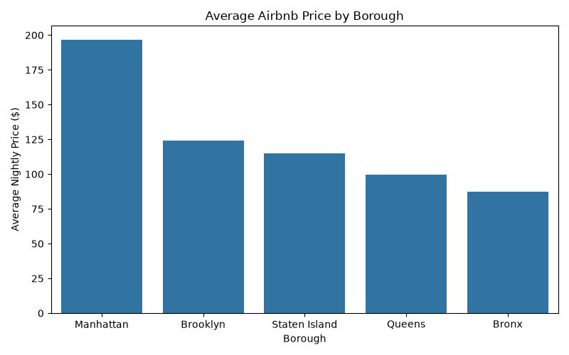
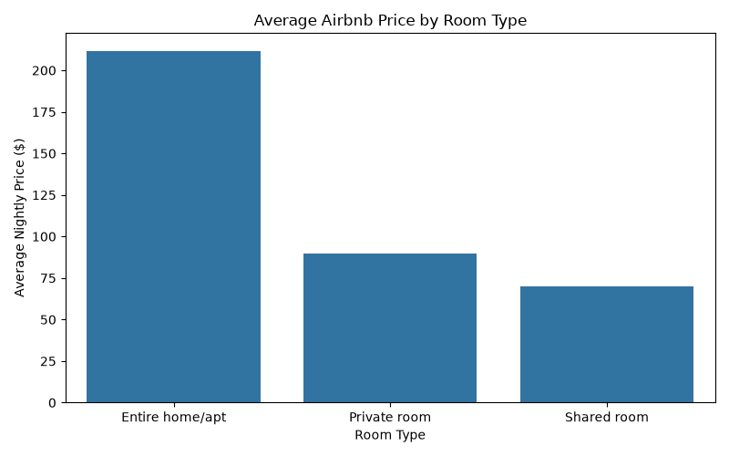

# Airbnb Market Analysis

## Executive Summary

This project analyzed approximately 49,000 Airbnb listings in New York City using PostgreSQL and Python to identify pricing drivers, market concentration, and revenue opportunities.

Results showed that location and accommodation type were the strongest pricing drivers. Manhattan commanded the highest average nightly rates while entire-home listings generated a substantial premium over private-room accommodations. The analysis also identified evidence of professional inventory management among a subset of hosts.

---

## Objective

Analyze Airbnb listing data to identify pricing trends, market concentration, and revenue opportunities within the New York City Airbnb marketplace.

---

## Dataset

New York City Airbnb Open Data

---

## Tools

- PostgreSQL
- SQL
- Python
- Pandas
- Jupyter Notebook
- Matplotlib
- Seaborn
- Git
- GitHub

---

## Skills Demonstrated

- SQL Aggregation and Filtering
- Window Functions
- Exploratory Data Analysis (EDA)
- Data Cleaning
- Business Analytics
- Data Visualization
- Git Version Control
- Documentation and Reporting

---

## SQL Analysis

The dataset was imported into PostgreSQL and analyzed using aggregation, grouping, filtering, and window functions to identify pricing trends and marketplace characteristics.

### Average Price by Borough

**Business Question:** Which boroughs command the highest average nightly rates?

**Result:**

| Borough | Avg. Price ($) | Listings |
|----------|----------:|----------:|
| Manhattan | 196.88 | 21,661 |
| Brooklyn | 124.38 | 20,104 |
| Staten Island | 114.81 | 373 |
| Queens | 99.52 | 5,666 |
| Bronx | 87.50 | 1,091 |

**Insight:**

Manhattan recorded both the highest average nightly price and the largest inventory of listings, making it the most economically significant Airbnb market in New York City.

---

### Average Price by Room Type

**Business Question:** How does accommodation type influence pricing?

**Result:**

| Room Type | Avg. Price ($) |
|------------|----------:|
| Entire Home/Apt | 211.79 |
| Private Room | 89.78 |
| Shared Room | 70.13 |

**Insight:**

Entire-home listings generated approximately 136% higher nightly rates than private-room listings, suggesting room type is a major driver of revenue potential.

---

### High-Value Neighborhoods

**Business Question:** Which neighborhoods combine strong pricing with meaningful inventory?

**Result:**

| Neighborhood | Avg. Price ($) | Listings |
|--------------|----------:|----------:|
| Tribeca | 490.64 | 177 |
| Battery Park City | 367.56 | 70 |
| Flatiron District | 341.93 | 80 |
| SoHo | 287.10 | 358 |
| Midtown | 282.72 | 1,545 |

**Insight:**

Tribeca achieved the highest average nightly rate, while Midtown combined premium pricing with substantial inventory volume, suggesting strong revenue potential at scale.

---

### Host Concentration

**Business Question:** Is inventory distributed among many hosts or concentrated among a small number of operators?

**Result:**

The largest host maintained 327 active listings, while several professional operators managed portfolios exceeding 90 listings.

**Insight:**

Organizations such as Sonder, Blueground, and Corporate Housing indicate that a meaningful portion of Airbnb inventory is professionally managed rather than operating solely as a peer-to-peer marketplace.

---

## Python Analysis

Python was used to perform exploratory data analysis, evaluate data quality, identify missing values, calculate correlations, and generate visualizations.

### Data Quality Assessment

Review-related fields contained approximately 10,000 missing values. Further investigation suggested these missing records likely corresponded to listings with little or no review activity rather than data-quality issues.

### Correlation Analysis

Correlations between price and several operational variables were found to be weak:

| Variable | Correlation with Price |
|----------|----------:|
| Number of Reviews | -0.048 |
| Availability | 0.082 |
| Minimum Nights | 0.043 |

**Insight:**

Location and room type appeared to have a much stronger influence on pricing than review volume, availability, or minimum-night requirements.

---

## Visualizations

### Average Price by Borough



### Average Price by Room Type



---

## Key Findings

1. Manhattan had the highest average nightly rate ($196.88) and the largest listing inventory.
2. Entire-home listings generated approximately 136% higher rates than private-room listings.
3. Location and room type were stronger pricing drivers than review volume, availability, or minimum-night requirements.
4. High-value neighborhoods included Tribeca, Battery Park City, SoHo, and Midtown.
5. A meaningful portion of marketplace inventory appears to be controlled by professional operators.

---

## Business Recommendations

### Pricing Strategy

Hosts seeking to maximize revenue should prioritize entire-home listings where feasible, as these command substantially higher nightly rates.

### Market Selection

Manhattan remains the strongest market due to its combination of premium pricing and inventory volume.

### Neighborhood Opportunity

Midtown appears particularly attractive because of its balance of high average pricing and significant listing activity.

### Marketplace Structure

The presence of large commercial operators suggests Airbnb functions as both a peer-to-peer marketplace and a professional hospitality platform.

---

## Repository Structure

```text
airbnb-analysis/
│
├── data/
├── figures/
├── notebooks/
├── sql/
├── README.md
│
├── sql/
│   ├── 01_price_by_borough.sql
│   ├── 02_price_by_room_type.sql
│   ├── 03_top_neighbourhoods.sql
│   ├── 04_host_concentration.sql
│   ├── 05_neighbourhood_pricing_rank.sql
│   └── 06_professional_hosts.sql
│
└── notebooks/
    └── airbnb_analysis.ipynb
```

---

## Future Work

- Investigate price outliers and their effect on market averages
- Estimate occupancy and potential annual revenue
- Develop predictive models for listing prices
- Conduct geographic clustering analysis
- Build an interactive dashboard using Power BI

---

## Status

✅ Complete (Version 1.0)